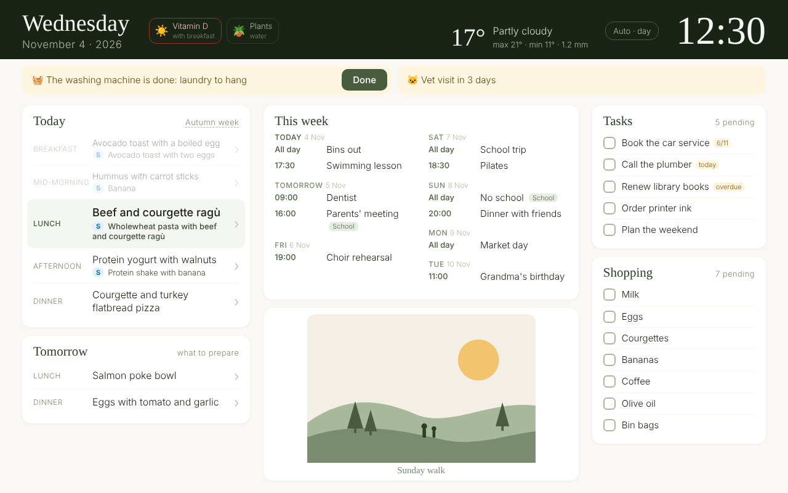
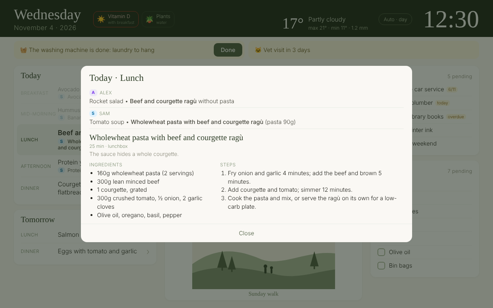
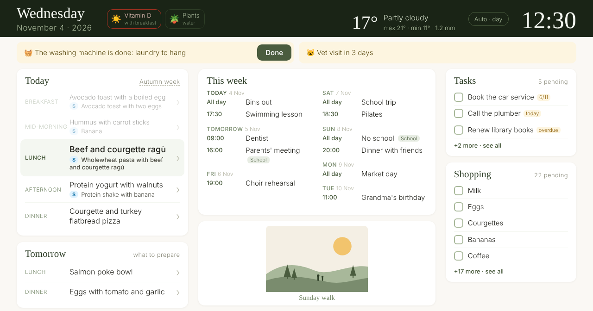
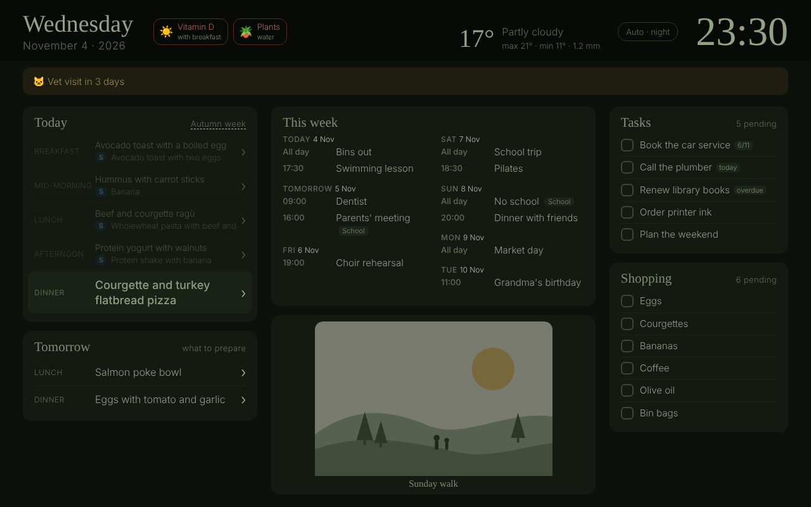
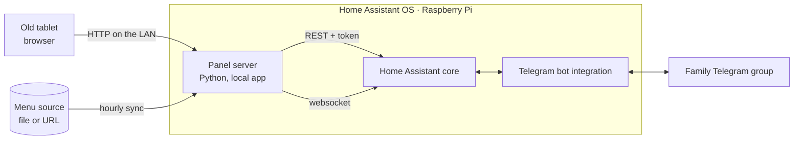

# Old Tablet Dashboard

Turn the tablet that sits in a drawer into an always-on family panel: today's meals, the week's agenda, tasks, the shopping list, weather and a few photos, readable from across the kitchen. Works on browsers as old as **Chrome 40 / Android 4.4 (2014)**, runs inside **Home Assistant OS** so no computer needs to stay on, and the household edits the lists from **Telegram**.



🇪🇸 [Guía paso a paso en español](docs/es/guia.md)

## What it does

- **Meals** — today's menu with the current meal highlighted and past ones faded; tomorrow's lunch and dinner ("what to prepare today"). Tap a meal to see everyone's dish and the matching recipe.
- **Agenda** — the next seven days from every Home Assistant calendar (Google Calendar works through its secret iCal address).
- **Tasks and shopping** — Home Assistant to-do lists; tap an item to tick it off.
- **Weather, alerts, daily checklist, photos** — "laundry is waiting" banners from HA helpers, reminders before a date, vitamin/plant chips that every screen shares, and pictures filling the free space.
- **Fits one screen, always** — long lists collapse into "+N more · see all" before the text shrinks. Night mode from 23:00.
- **Telegram** — `+ milk, eggs` adds to the shopping list sorted by supermarket aisle, `- eggs` removes, `! call the plumber @friday` adds a task, `/menu` offers the week's shopping as checkboxes, `/help` explains it all.
- **English and Spanish**, for the panel and the bot.

| Meal detail with recipe | Long lists on a short screen | Night |
|---|---|---|
|  |  |  |

## Try it in one minute

You only need Python 3.9+.

```bash
git clone https://github.com/lapencadev/old-tablet-dashboard.git
cd old-tablet-dashboard
python -m pip install -r requirements.txt
python tools/panel.py demo            # or: python tools/panel.py demo --lang es
```

Open <http://localhost:8000>. The demo runs a fake Home Assistant with example calendars and lists, so nothing has to be configured. (On macOS/Linux use `python3` if `python` is not found.)

## How it works



- The **panel** is one static page in ES5 JavaScript (no build step), designed for 2014 browsers.
- The **server** serves the page, adds the Home Assistant token when proxying (the tablet never sees it), keeps a little shared state (the week picked by hand, checklist ticks), syncs the menu and answers `/menu` and `/help`.
- **Home Assistant automations** (rendered from templates) handle `+`, `-`, `!`, `/shopping` and `/tasks`.

## Set it up for real

The full walkthrough, with macOS and Windows commands side by side, is in **[docs/guide.md](docs/guide.md)** ([español](docs/es/guia.md)). In short:

1. Copy `.env.example` to `.env` and fill in your Home Assistant address and a long-lived token. `python tools/panel.py ha-check` lists the calendars and lists you can use.
2. Copy `panel/config.example.js` to `panel/config.js` and pick your entities, alerts, checklist and photos.
3. Write your menu in `panel/data/menu.js` ([format](docs/domain-model.md)) or let the server sync it from a URL.
4. `python tools/panel.py deploy-app` installs the server as a Home Assistant OS local app over SSH.
5. Open `http://<HA_IP>:8000` on the tablet and add it to the home screen.
6. Optional: create a Telegram bot, then `python tools/panel.py deploy-ha` installs the shopping and task commands.

Something not working? **[docs/troubleshooting.md](docs/troubleshooting.md)** lists every problem met while building the original setup, with the fix.

## Commands

| Command | What it does |
|---|---|
| `python tools/panel.py demo [--lang es]` | Panel with a fake Home Assistant and example data |
| `python tools/panel.py serve` | Server against your Home Assistant (settings in `.env`) |
| `python tools/panel.py ha-check` | Lists your calendars, to-do lists, weather and helpers |
| `python tools/panel.py validate-menu [file]` | Checks a menu file |
| `python tools/panel.py deploy-app` | Installs/updates the Home Assistant OS local app (SSH) |
| `python tools/panel.py deploy-ha [--lang es]` | Installs the Telegram automations in Home Assistant |
| `python tools/panel.py tablet-shot` | Screenshot of the tablet (adb) |
| `python tools/panel.py tablet-debloat [--restore]` | Disables apps the panel does not need (adb) |
| `python tools/panel.py tablet-open <url>` | Opens the panel in the tablet's browser (adb) |
| `python tools/panel.py check` (or `./init.sh`) | Every automated test |

## Menu sources

The panel reads one simple format (`var MENU = {people, meals, weeks, shopping}`, see [docs/domain-model.md](docs/domain-model.md)). You can write it by hand, generate it with any tool, or sync it every hour from a website through an **adapter**. The repo ships two: `generic` (a URL that already serves the format) and `static-site`, the format of the author's own meal-planning website, with an optional password-protected part. Both are described in [docs/menu-sources.md](docs/menu-sources.md) so you can publish your site the same way or write your own adapter.

## Built with an AI coding agent

Every line here was written by an AI coding agent from a described problem, and the repository shows the method instead of hiding it:

- Discovery first: [`CONTEXT.md`](CONTEXT.md), [`docs/build-brief.md`](docs/build-brief.md), [`docs/domain-model.md`](docs/domain-model.md), [`DESIGN.md`](DESIGN.md).
- Agent-ready repo: [`AGENTS.md`](AGENTS.md), [`feature_list.json`](feature_list.json) (each feature with its verification and evidence), [`PROGRESS.md`](PROGRESS.md), [`init.sh`](init.sh), and one spec per feature in [`docs/specs/`](docs/specs).
- Work closes with evidence: Python unit tests, JavaScript logic tests in a sandbox, an ES5 syntax gate, and Playwright scenarios against the demo.

The method is [harness-starter](https://github.com/devexpert-io/harness-starter) by Antonio Leiva / DevExpert ([announcement](https://x.com/antonioleivag/status/2113301480023155039)).

## Credits and inspiration

- **The idea**: [Antonio Leiva's post](https://x.com/antonioleivag/status/2112870497260077245) about turning an old tablet into a desk dashboard, after people started running dashboards on cheap digital photo frames. Only the idea comes from there: this code and architecture are original.
- **Working method**: [harness-starter](https://github.com/devexpert-io/harness-starter) (MIT), linked, not copied.
- **Built on**: [Home Assistant](https://www.home-assistant.io/) (OS, to-do lists, Remote Calendar, Telegram bot integrations), [Telegram Bot API](https://core.telegram.org/bots/api), [Tailscale](https://tailscale.com/) for remote access, [json5](https://pypi.org/project/json5/) and [websockets](https://pypi.org/project/websockets/) for Python; [acorn](https://github.com/acornjs/acorn) and [Playwright](https://playwright.dev/) for the tests.

## Future ideas

- Free-text requests to the bot with an AI model ("we're out of the usual breakfast stuff").
- More menu adapters (Mealie, Paprika, a Google Sheet).
- An alerts panel for things that need attention (low battery sensors, open windows).
- A photo frame mode that rotates albums at night.

## License

[MIT](LICENSE)
