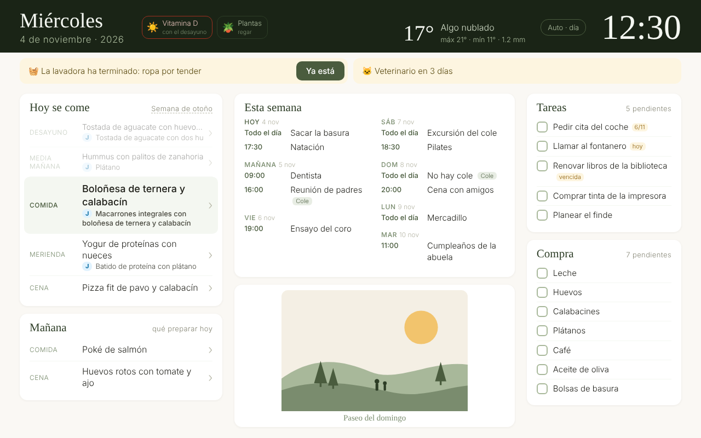

# Guía paso a paso

De una tablet vieja y un Home Assistant OS a un panel siempre encendido y un grupo de Telegram que edita las listas. Cada comando aparece para **macOS** y **Windows** (Linux funciona como macOS).

> Los nombres de los menús de Home Assistant son los de 2026, donde los complementos se llaman **Aplicaciones**. Si tu versión dice «Complementos», es el mismo sitio.

🇬🇧 [English version](../guide.md) · [Problemas frecuentes](problemas.md)

- [0. Qué necesitas](#0-qué-necesitas)
- [1. Descarga el proyecto y prueba la demo](#1-descarga-el-proyecto-y-prueba-la-demo)
- [2. Prepara Home Assistant](#2-prepara-home-assistant)
- [3. Configura el panel](#3-configura-el-panel)
- [4. Instala el servidor dentro de Home Assistant](#4-instala-el-servidor-dentro-de-home-assistant)
- [5. Dale a Home Assistant una dirección fija](#5-dale-a-home-assistant-una-dirección-fija)
- [6. Prepara la tablet](#6-prepara-la-tablet)
- [7. Telegram: compra, tareas y /menu](#7-telegram-compra-tareas-y-menu)
- [8. Tu menú](#8-tu-menú)
- [9. Fuera de casa (Tailscale)](#9-fuera-de-casa-tailscale)
- [10. Actualizar y comandos del día a día](#10-actualizar-y-comandos-del-día-a-día)



## 0. Qué necesitas

| | Notas |
|---|---|
| Una tablet o un móvil viejo | Cualquier cosa con navegador. Probado en una tablet de 2014 con Android 4.4 y Chrome 40. Un cable USB que transmita **datos** (no solo carga). |
| Home Assistant OS | En una Raspberry Pi o un ordenador pequeño, en la misma red. |
| Un ordenador | macOS o Windows, solo para la instalación. Después puede estar apagado. |
| Python 3.9 o superior | macOS: `python3 --version` en Terminal (si te pide instalar las herramientas de línea de comandos, acepta). Windows: instálalo desde python.org y marca **Add python.exe to PATH**. |
| Telegram (opcional) | Para los comandos de compra y tareas. |

## 1. Descarga el proyecto y prueba la demo

macOS (Terminal):

```bash
git clone https://github.com/lapencadev/old-tablet-dashboard.git
cd old-tablet-dashboard
python3 -m pip install -r requirements.txt
python3 tools/panel.py demo --lang es
```

Windows (PowerShell):

```powershell
git clone https://github.com/lapencadev/old-tablet-dashboard.git
cd old-tablet-dashboard
python -m pip install -r requirements.txt
python tools\panel.py demo --lang es
```

¿Sin git? Descarga el ZIP desde GitHub (**Code → Download ZIP**) y descomprímelo.

Abre <http://localhost:8000>: verás el panel con un Home Assistant de mentira. Para pararlo, Ctrl+C.

A partir de aquí la guía escribe `python tools/panel.py`; en macOS escribe `python3`, y en Windows puedes usar `tools\panel.py` con la barra invertida.

## 2. Prepara Home Assistant

### 2.1 Un token de larga duración

1. En Home Assistant pulsa tu nombre (abajo a la izquierda) → pestaña **Seguridad**.
2. **Tokens de acceso de larga duración → Crear token**, llámalo «panel» y cópialo (solo se enseña una vez).

### 2.2 El archivo `.env`

Copia `.env.example` como `.env` (macOS: `cp .env.example .env`; Windows: `copy .env.example .env`) y edítalo:

```ini
HA_URL=http://<IP_DE_HA>:8123
HA_TOKEN=<el token>
```

**El puerto `:8123` es obligatorio.** La dirección la ves en **Configuración → Sistema → Red**, o en la lista de dispositivos del router.

Compruébalo:

```bash
python tools/panel.py ha-check
```

Te enseña tus calendarios, listas de tareas, el tiempo y los ayudantes. Si dice 401, el token está mal; si no conecta, revisa la dirección y el puerto.

### 2.3 Calendarios

Google Calendar sin credenciales de Google Cloud:

1. En Google Calendar desde un ordenador: **Configuración → (tu calendario) → Integrar el calendario → Dirección secreta en formato iCal**. Cópiala.
2. En Home Assistant: **Configuración → Dispositivos y servicios → Añadir integración → Remote Calendar**, pega la dirección y ponle nombre.
3. Repite con cada calendario que quieras en el panel. El de `MAIN_CALENDAR` sale sin etiqueta; los demás llevan una pequeña etiqueta con su nombre.

Remote Calendar descarga los calendarios una vez al día. En el paso 7 se instala una automatización que los actualiza cada 15 minutos (puedes instalar solo esa: `python tools/panel.py deploy-ha --only calendar`).

### 2.4 Listas de tareas y compra

**Configuración → Dispositivos y servicios → Añadir integración → Local To-do** (Lista de tareas local): crea una lista *Compra* y otra *Tareas*. Sus entidades serán algo como `todo.compra` y `todo.tareas` (compruébalo con `ha-check`).

### 2.5 Avisos (opcional)

Los avisos del tipo «la lavadora ha terminado» salen de ayudantes `input_boolean` que tus automatizaciones encienden: **Configuración → Dispositivos y servicios → Ayudantes → Crear ayudante → Interruptor**. Los recordatorios de una fecha usan un ayudante de **Fecha** o **Fecha y hora**.

## 3. Configura el panel

Copia `panel/config.example.js` como `panel/config.js` y edítalo. Cada opción está explicada en el archivo:

- `LANG`: `'es'` o `'en'`.
- `CALENDARS` (`'auto'` = todos), `MAIN_CALENDAR`, `TASKS`, `SHOPPING`, `WEATHER`.
- `ALERTS` y `DATE_ALERTS`: tus ayudantes y el texto del aviso.
- `CHECKLIST`: recordatorios diarios con una franja horaria (vitaminas, plantas…).
- `PHOTOS`: pon las imágenes en `panel/img/` y añádelas a la lista. Git las ignora, así que tus fotos no se publican.

Pruébalo con tu Home Assistant de verdad antes de instalar nada:

```bash
python tools/panel.py serve
```

y abre <http://localhost:8000>.

## 4. Instala el servidor dentro de Home Assistant

Para que el panel funcione con el ordenador apagado, el servidor corre como **aplicación local** dentro de Home Assistant OS.

### 4.1 Acceso por SSH

1. **Configuración → Aplicaciones → Instalar aplicación** (el botón de la tienda) → busca **Terminal & SSH** → Instalar.
2. Crea una clave SSH en tu ordenador si no tienes:
   - macOS: `ssh-keygen -t ed25519` (Enter para aceptar lo que propone) y luego `cat ~/.ssh/id_ed25519.pub`.
   - Windows (PowerShell): `ssh-keygen -t ed25519` y luego `type $env:USERPROFILE\.ssh\id_ed25519.pub`. Si no existe `ssh`: **Configuración → Aplicaciones → Características opcionales → Cliente OpenSSH**.
3. En la aplicación Terminal & SSH → pestaña **Configuración**: pega la clave pública en `authorized_keys` y, en **Red**, pon el puerto 22. Guarda e inicia la aplicación.
4. Prueba: `ssh root@<IP_DE_HA>`. Debe salir el terminal de Home Assistant.

Añade al `.env`:

```ini
HA_SSH=root@<IP_DE_HA>
```

(Si tu clave no es la de por defecto, añade `HA_SSH_KEY=~/.ssh/tu_clave`.)

### 4.2 Instalar

```bash
python tools/panel.py deploy-app
```

Sube la aplicación a `/local_apps/tablet_panel`, la instala y la arranca. La primera vez tarda unos minutos en una Raspberry Pi. Después de cada cambio, el mismo comando: lo detecta como actualización.

Abre `http://<IP_DE_HA>:8000` desde cualquier dispositivo de tu red.

### 4.3 Opciones de la aplicación

**Configuración → Aplicaciones → Old Tablet Dashboard → Configuración**:

| Opción | |
|---|---|
| `lang` | Idioma del bot de Telegram. |
| `menu_url`, `menu_adapter`, `menu_people`, `menu_password`, `recipes_url` | Sincronizar el menú (paso 8). Vacío = el menú que subiste con la aplicación. |
| `telegram_chat_id` | Id del grupo para `/menu` y `/ayuda` (paso 7). |

La pestaña **Registro** enseña qué hace el servidor (sincronización del menú, conexión con Telegram, errores de Home Assistant).

## 5. Dale a Home Assistant una dirección fija

La tablet abre `http://<IP_DE_HA>:8000`, así que esa dirección no puede cambiar. En el router busca **DHCP / reserva de direcciones / IP estática** (suele estar en un menú avanzado) y reserva la dirección actual para Home Assistant. Guarda, y si el router tiene un paso aparte de «guardar configuración» (en algunos, **Mantenimiento → Guardar**), hazlo también.

## 6. Prepara la tablet

### 6.1 Depuración USB

1. **Ajustes → Información del tablet** → toca **Número de compilación** siete veces hasta que diga que eres desarrollador.
2. **Ajustes → Opciones de desarrollo** → activa **Depuración USB** y **Pantalla activa** (no se apaga mientras carga).

### 6.2 adb en tu ordenador

- macOS: `brew install android-platform-tools` (o descarga *SDK Platform-Tools* de developer.android.com).
- Windows: descarga *SDK Platform-Tools for Windows*, descomprímelo (por ejemplo en `C:\platform-tools`) y añade esa carpeta al PATH (**Editar las variables de entorno del sistema → Variables de entorno → Path → Nuevo**).

Conecta la tablet, acepta el aviso «¿Permitir depuración USB?» en su pantalla y comprueba:

```bash
adb devices
```

¿Lista vacía? Prueba otro cable (muchos solo cargan) y cambia el modo USB de la tablet a **PTP** (cámara).

### 6.3 Wi-Fi y el panel

- Las tablets viejas a menudo solo ven redes de **2,4 GHz**. Si no aparece tu red, conéctate a la de 2,4 GHz.
- Abre el panel: `python tools/panel.py tablet-open http://<IP_DE_HA>:8000`, o escribe la dirección en el navegador.
- Menú del navegador → **Añadir a pantalla de inicio**: se abre a pantalla completa. Ahí no hay botón de recargar: **toca la hora** para recargar.

### 6.4 Limpiar la tablet (opcional)

```bash
python tools/panel.py tablet-debloat --dry-run   # ver qué haría
python tools/panel.py tablet-debloat
```

Desactiva (no borra) las aplicaciones de `config/debloat.txt`; edita la lista para tu tablet. `--restore` las recupera. En Android 4.4 adb no puede desactivar aplicaciones del sistema, así que las oculta con `pm block`.

Captura de la tablet: `python tools/panel.py tablet-shot` (se guarda en el Escritorio).

## 7. Telegram: compra, tareas y /menu

### 7.1 El bot

1. En Telegram, habla con **@BotFather** → `/newbot`, elige nombre y usuario, y copia el **token**.
2. `/setprivacy` → elige el bot → **Disable**. Sin esto, el bot no ve mensajes como `+ leche` en los grupos. Si el bot ya estaba en el grupo, sácalo y vuelve a meterlo.
3. Crea un grupo con los de casa y añade el bot.

### 7.2 La integración de Telegram en Home Assistant

1. **Configuración → Dispositivos y servicios → Añadir integración → Telegram bot**, plataforma **Polling**, pega el token.
2. Averigua el id del grupo: escribe algo en el grupo y en **Herramientas para desarrolladores → Eventos** escucha `telegram_text`; mira `chat_id` (un número negativo que empieza por `-100`).
3. Permite ese chat en la integración (opción *chats permitidos* o *Añadir chat*, según la versión).

### 7.3 Instalar los comandos

Añade al `.env`:

```ini
TELEGRAM_CHAT_ID=-100xxxxxxxxxx
PANEL_LANG=es
HA_SHOPPING=todo.compra
HA_TASKS=todo.tareas
```

```bash
python tools/panel.py deploy-ha --dry-run   # ver qué va a crear
python tools/panel.py deploy-ha
```

Crea las automatizaciones y scripts (todos sus ids empiezan por `otd_`). Para `/menu` y `/ayuda`, pon también `telegram_chat_id` en las opciones de la aplicación (paso 4.3) y reiníciala.

### 7.4 Sugerencias al escribir «/»

@BotFather → `/setcommands` → elige el bot → envía todas las líneas en un solo mensaje (sustituye la lista entera, así que incluye los comandos que tu bot ya tuviera):

```text
compra - Ver la lista de la compra por secciones
tareas - Ver las tareas pendientes
menu - Sugerir la compra del menú de la semana
ayuda - Ver todos los comandos y cómo se usan
```

### 7.5 Uso

| Escribes en el grupo | Qué pasa |
|---|---|
| `+ leche, huevos y pan` | Se añade, ordenado por secciones del súper; avisa si algo ya estaba |
| `- huevos` | Se quita |
| `/compra` | La lista por secciones, con un botón por producto para tacharlo |
| `! llamar al fontanero @viernes` | Tarea con fecha: `@hoy`, `@mañana`, un día de la semana o `@15/11` |
| `/tareas` | Las tareas por fecha, con botones para marcarlas hechas |
| `/menu` | La compra que pide el menú de la semana, con casillas → **Añadir** |
| `/ayuda` | Todos los comandos con un ejemplo |

Las secciones del súper (vienen las del Mercadona) y los nombres de los comandos están en `config/ha.es.json`: edítalos y vuelve a lanzar `deploy-ha`.

## 8. Tu menú

El panel lee `panel/data/menu.js`. Parte de `panel/data/menu.example.es.js`; el formato está en [domain-model.md](../domain-model.md) (en inglés):

- `people`: quién come (el primero es el principal; los demás solo aparecen si su plato es distinto).
- `meals`: id, nombre, la hora a la que termina cada comida (`until`) y si sale en «Mañana».
- `weeks`: siete días cada una, con `start` (un lunes) y `repeat` (2 = el mismo menú dos semanas seguidas).
- `shopping`: productos por semana para `/menu`. Una línea puede llevar varios productos separados por comas.
- Pon el plato principal en `<strong>`: es lo que enseña el panel; el resto aparece al tocar la comida.

Compruébalo con `python tools/panel.py validate-menu` y luego `deploy-app`.

**Recetas**: `panel/data/recipes.json` (como `recipes.example.es.json`). Al tocar una comida sale la receta cuyo título se parece más al plato principal.

**Sincronizar desde una web**: pon `menu_url` (y `menu_adapter`) en las opciones de la aplicación. `generic` descarga un archivo que ya tiene este formato; `static-site` lee una web de menús hecha con archivos estáticos, aunque tenga una parte privada con contraseña (`menu_password`). Los dos formatos, con ejemplos, están en [fuentes-de-menu.md](fuentes-de-menu.md).

**Elegir semana a mano**: toca el nombre de la semana junto a «Hoy se come». La elección la comparten todas las pantallas y `/menu`; elige *Automático* para volver a las fechas. Un menú nuevo aparece el día que empieza.

## 9. Fuera de casa (Tailscale)

1. **Configuración → Aplicaciones → Instalar aplicación → Tailscale** → instala, inicia, abre su interfaz web e inicia sesión.
2. Instala Tailscale en el móvil con la misma cuenta.
3. En la **Aplicación Companion** de Home Assistant, añade la dirección de Tailscale **con el puerto**: `http://<nombre-tailscale-o-100.x.y.z>:8123`. El panel está en la misma dirección con `:8000`.

Para dar acceso a otra persona sin compartir tu cuenta: en la consola de Tailscale, **Users → Invite**, o comparte solo la máquina de Home Assistant.

## 10. Actualizar y comandos del día a día

```bash
git pull
python tools/panel.py deploy-app
```

| Para… | Comando |
|---|---|
| Comprobar que todo sigue pasando | `python tools/panel.py check` |
| Una captura de la tablet | `python tools/panel.py tablet-shot` |
| Reinstalar los comandos de Telegram tras cambiar textos | `python tools/panel.py deploy-ha` |
| Ver qué entidades hay | `python tools/panel.py ha-check` |

Problemas: [problemas.md](problemas.md).
